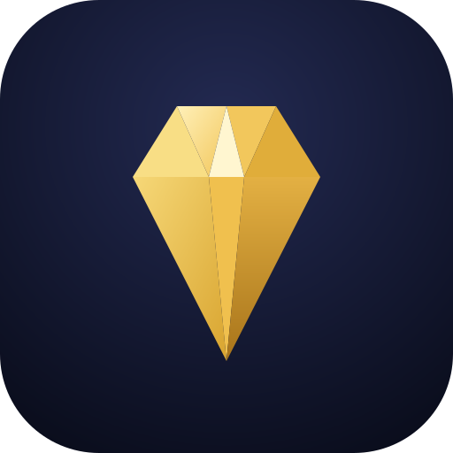
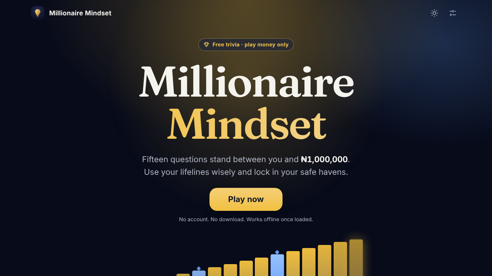

<div align="center">
  <picture>
    <source media="(prefers-color-scheme: dark)" srcset="docs/assets/logo-dark.svg">
    
  </picture>

# Millionaire Mindset

**15 questions. Three lifelines. Two safe havens. ₦1,000,000 at the top.**

[](https://github.com/babatundeawo/Millionaire-Mindset/actions/workflows/deploy.yml)
[](https://babatundeawo.github.io/Millionaire-Mindset/)

[Play now](https://babatundeawo.github.io/Millionaire-Mindset/) · [Report an issue](https://github.com/babatundeawo/Millionaire-Mindset/issues)


</div>

## About

Millionaire Mindset is a free quiz game that runs in your browser. There is no account, no download and no real money. Climb a 15-step prize ladder, use your lifelines wisely, and decide whether to risk it or walk away.

## Features

- 15 questions, easy to very hard, drawn at random from a bank of 269
- Answer order is shuffled every game
- 50:50, Phone a friend and Ask the audience, each usable once
- Safe havens at question 5 (₦1,000) and question 10 (₦32,000)
- Walk away at any time and keep your last secured prize
- Light and dark themes
- Installable on your phone or computer, and playable offline
- Keyboard play (A to D), sound with a mute switch, optional vibration, reduced-motion support
- Optional AI-written questions using your own free Groq key (stored only in your browser)

## How to play

Open the site and press **Play now**. Choose an answer, then press **Final answer** to lock it in. Walk away whenever you like to keep your last secured prize. To install the game, use the **Install** button on the home screen (on iPhone: Share, then Add to Home Screen).

## Tech stack

React 19, TypeScript, hand-written CSS, esbuild, and a small service worker. Fonts (Inter and Fraunces) are included with the site, so nothing is loaded from third parties.

## Project structure

```text
src/
  game/        rules, prize ladder, lifelines, question draw
  data/        the question bank
  pages/       home, game, result, not found
  components/  buttons, dialogs, ladder, install prompt
  lib/         settings, storage, AI questions, theme
  styles/      colour tokens and styles
  sw.ts        offline service worker
scripts/       build and check scripts
tests/         game rule tests
docs/          notes for the site owner
```

## Contributing

See [CONTRIBUTING.md](CONTRIBUTING.md). To report a security problem, see [SECURITY.md](SECURITY.md).

## Credits

Fonts: [Inter](https://rsms.me/inter/) and [Fraunces](https://github.com/undercasetype/Fraunces), both under the SIL Open Font License (copies in `src/assets/fonts`).

Millionaire Mindset is an independent fan-made game and is not affiliated with any television programme.
